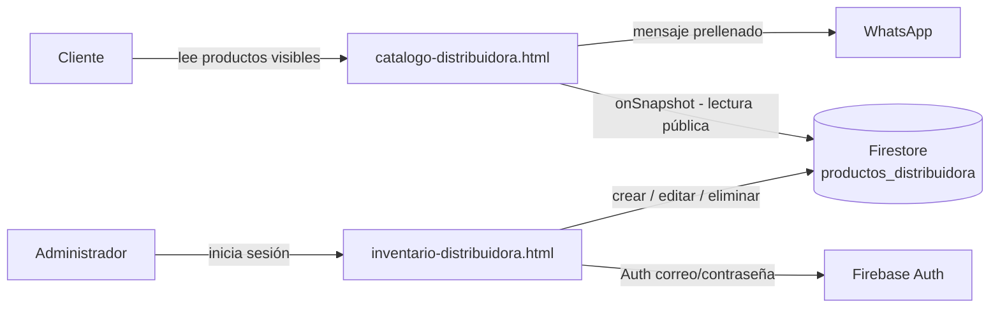

<div align="center">

# 🛒 Catálogo y Panel de Inventario — Distribuidora Medina & Medel

**Catálogo público de productos con pedidos por WhatsApp y un panel privado de administración, conectados en tiempo real mediante Firebase.**


</div>

---

<!--
  💡 Tip: agrega capturas del catálogo y del panel.
  1) Crea la carpeta docs/ y sube las imágenes, por ejemplo docs/catalogo.png y docs/panel.png
  2) Descomenta estas líneas:
  <p align="center"> </p>
-->

## 🎯 Descripción

Aplicación web para una distribuidora que vende productos con **envío gratis a todo Chile**. Tiene dos partes:

| Parte | Archivo | Quién la usa |
|---|---|---|
| **Catálogo público** | `catalogo-distribuidora.html` | Clientes: ven productos, eligen pack y piden por WhatsApp |
| **Panel de administración** | `inventario-distribuidora.html` | Dueño: inicia sesión y sube, edita, oculta o elimina productos |

Los cambios hechos en el panel aparecen **al instante** en el catálogo, sin recargar la página.

## ✨ Funcionalidades

**Catálogo (clientes)**
- Grilla de productos con filtros por categoría y búsqueda.
- **Packs con precios escalonados**: 1 unidad, pack x2 y media docena (tarifa mayorista), con cálculo automático de totales.
- **Galería de hasta 6 fotos por producto**: flechas, puntos, miniaturas, teclado y deslizar con el dedo.
- **Descripciones con formato**: reconoce ítems con ✅, viñetas, subtítulos y párrafos a partir de texto plano.
- **Pedido por WhatsApp** con mensaje prellenado (producto, pack y total).
- En celular, la ficha del producto se abre como *hoja inferior* con barra de compra fija.
- Desplazamiento suave animado que respeta `prefers-reduced-motion`.

**Panel (administrador)**
- **Login con Firebase Authentication** (correo y contraseña).
- Alta, edición, ocultar/mostrar y eliminación de productos.
- **Subida múltiple de fotos** con compresión automática y reordenamiento (la primera es la portada).
- Control del peso del producto para respetar el límite de 1 MB por documento de Firestore.
- Campos de precio que aceptan formato chileno (`18990`, `18.990` o `$18.990`) y se formatean en vivo.
- Herramienta que **repara precios** guardados con un formato incorrecto.

## 🧱 Arquitectura



No hay servidor propio: el sitio es estático y Firebase actúa como base de datos y autenticación.

## 🛠️ Tecnologías

| Área | Herramientas |
|---|---|
| Frontend | HTML5, CSS3 (Grid, Flexbox, `safe-area-inset`), JavaScript ES Modules (sin frameworks ni build) |
| Base de datos | Cloud Firestore con listeners en tiempo real (`onSnapshot`) |
| Autenticación | Firebase Authentication (correo y contraseña) |
| Rendimiento | Caché persistente en IndexedDB, detección automática de *long polling*, `preconnect` a los servicios, carga diferida de imágenes |
| Hosting | Vercel (sitio estático) |
| Pedidos | Enlaces `wa.me` con mensaje prellenado |

## 🧠 Decisiones técnicas

- **Sin backend propio**: Firebase cubre base de datos, autenticación y tiempo real, reduciendo costo y mantenimiento.
- **Caché local persistente**: el catálogo se muestra de inmediato desde IndexedDB en visitas repetidas mientras llega la versión nueva.
- **Compatibilidad de red**: se activa la detección automática de *long polling* para redes, VPN o antivirus que bloquean el canal de streaming de Firestore.
- **Precios en CLP sin errores**: se guardan como pesos enteros y el formateo no depende de `Intl` del dispositivo, evitando que `18.990` se lea como `18,99`.
- **Fotos dentro del documento**: se comprimen en el navegador y se guardan en Firestore (límite de 1 MB). El siguiente paso natural es migrar a Firebase Storage.
- **Protección contra XSS**: todo texto proveniente de la base de datos se escapa antes de insertarse en el HTML.
- **Móvil primero**: inputs de 16 px (sin zoom en iOS), bloqueo correcto del scroll de fondo en Safari y respeto del notch.

## 📁 Estructura

```
├── catalogo-distribuidora.html     # Catálogo público
├── inventario-distribuidora.html   # Panel privado de administración
├── firebaseMedinaMedel.js          # Conexión y funciones de Firebase (Firestore + Auth)
└── productsMockData.js             # Datos de ejemplo y categorías
```

## 🚀 Puesta en marcha

### 1. Crear tu proyecto de Firebase
1. En la [consola de Firebase](https://console.firebase.google.com) crea un proyecto y habilita **Firestore Database** (modo producción).
2. En **Authentication → Sign-in method** habilita *Correo electrónico/Contraseña*.
3. En **Authentication → Users** agrega **un único usuario administrador** y copia su **UID**.
4. En **Project settings → Tus apps → SDK setup**, copia la configuración web.

### 2. Conectar el código
Reemplaza `firebaseConfig` en `firebaseMedinaMedel.js` con tus valores y, en `catalogo-distribuidora.html`, configura:

```js
const DATA_SOURCE = 'firebase';          // 'mock' para probar con datos de ejemplo
const WHATSAPP_NUMBER = '56XXXXXXXXX';   // tu número con código de país
const CONTACT_EMAIL = 'tu@correo.com';
```

### 3. Reglas de seguridad de Firestore
Reemplaza el UID por el del administrador:

```
rules_version = '2';
service cloud.firestore {
  match /databases/{database}/documents {
    match /productos_distribuidora/{docId} {
      allow read: if true;                                   // el catálogo es público
      allow write: if request.auth != null
                   && request.auth.uid == 'UID_DEL_ADMINISTRADOR';
    }
  }
}
```

### 4. Ejecutar en local
Los módulos ES requieren un servidor (no funcionan abriendo el archivo directo):

```bash
npx serve .
# o
python -m http.server 8000
```

### 5. Publicar
Sube el repositorio a **Vercel** o GitHub Pages (sitio estático, sin build). Para que el catálogo sea la página principal, renómbralo a `index.html`.

## 🔐 Seguridad y privacidad

- **La configuración web de Firebase (`apiKey`, `projectId`, etc.) no es un secreto**: está diseñada para estar en el navegador y es visible para cualquier visitante. La seguridad real depende de las **Reglas de Firestore** y de la **configuración de Authentication**.
- Buenas prácticas aplicadas y recomendadas:
  - ✅ Lectura pública solo de la colección del catálogo; **escritura limitada al UID del administrador** (no basta con "usuario autenticado").
  - ✅ En *Authentication → Settings → User actions*, **desactivar el registro de usuarios** para que nadie pueda crearse una cuenta.
  - ✅ Restringir la API key por dominio (*HTTP referrers*) en Google Cloud Console → Credenciales.
  - ✅ El panel incluye `noindex` para que los buscadores no lo listen.
  - ✅ El texto de la base de datos se escapa antes de mostrarse (prevención de XSS).
- Este repositorio **no contiene** contraseñas, claves privadas ni credenciales de administrador, ni cuentas de servicio (`.gitignore` las bloquea).
- Los datos de contacto del negocio (WhatsApp y correo) son públicos por diseño, ya que se muestran a los clientes.

## 👤 Autor

**Benjamín Alonso Medina Medel** — Concepción, Chile
[LinkedIn](https://www.linkedin.com/in/benjamin-alonso-medina-medel-56b9a23b6) · [Instagram](https://instagram.com/bnjmn.mdn)

---

<sub>Proyecto de portafolio. Todos los derechos reservados.</sub>
